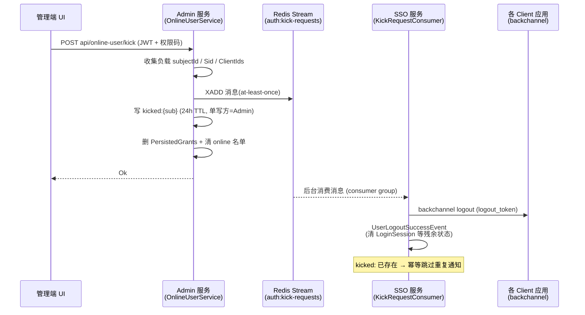

# 在线用户"强制下线"（踢人）重构设计留档

> 状态：设计留档（未实施）
> 目标实施分支：`OnlineUser` 功能分支（后续统一实施）
> 创建日期：2026-11-04
> 关联止血措施：`3afb7cff` fix(security): 封堵 SSO 三处鉴权漏洞（`wip-20261104` 分支，已提交；`main` 工作区有相同未提交改动）

---

## 1. 现状与问题

### 1.1 现有实现

强制下线链路（自 #1467 `Feat/online user` 引入）：

- **Admin 服务** `OnlineUserService.KickUserAsync`（`src/Services/Masa.Auth.Service.Admin/Services/OnlineUserService.cs`）：
  1. HTTP 调用 SSO 的 `POST /LogoutUserAsync?subjectId=xxx`（失败仅记日志，继续本地清理）；
  2. 直接删除 `auth.PersistedGrant` 表中该 subject 的全部 grants（token 失效）；
  3. 清理 Redis 在线名单 `online:users` 与会话缓存 `online:sso-session:{sub}`。
- **SSO 服务** `AccountController.LogoutUserAsync`（`src/Web/Masa.Auth.Web.Sso/Controllers/AccountController.cs`，约 199-252 行）：
  1. 读取 `LoginSession` 缓存，向各 Client 发 backchannel 登出通知（`_backChannelClient.SendLogoutNotificationsAsync`）；
  2. `_persistedGrantService.RemoveAllGrantsAsync(subjectId)`；
  3. 写入 `kicked:{subjectId}` 标记（24h TTL）——SSO 的 cookie 校验管道（`Program.cs` 的 `OnValidatePrincipal`）检测到该键即拒绝 principal 并强制登出；
  4. 抛 `UserLogoutSuccessEvent`（由 `IdentityServerEventSink` 清理在线名单与 `LoginSession`）。

该控制器整个类为 `[AllowAnonymous]`，端点本身无任何鉴权。

### 1.2 当前止血措施及其结构性缺陷

`wip-20261104` 分支已提交的止血（恢复内网 IP 检查 + GET 改 POST）只是网络层过滤，**不是身份认证**，存在三个结构性缺陷：

| # | 缺陷 | 说明 |
|---|------|------|
| 1 | 反代场景 fail-open | SSO 的 `Program.cs` 未配置 `UseForwardedHeaders`，`Connection.RemoteIpAddress` 是 TCP 直连对端。SSO 部署在内网 nginx/ingress 后面时，外网攻击流量经代理转发后来源 IP 是代理的内网 IP，检查被完全绕过。 |
| 2 | 无身份、无审计 | 通过检查的调用者依然匿名，无法回答"是谁踢了人"，审计、撤销、密钥轮换无从谈起。本质是拿网络层白名单充当应用层鉴权。 |
| 3 | 边角 fail-open | `remoteIp == null` 直接放行；IPv6 内网（非 loopback、非 IPv4-mapped）会被误拒。 |

### 1.3 可靠性缺口（与鉴权问题相互独立，一并修复）

SSO HTTP 调用失败时（SSO 重启中、跨网络拒收等），Admin 侧的本地清理会造成**踢一半**：

- grants 已删（token 失效），但 `kicked:{sub}` **无人写** → Web 端 SSO cookie 会话不死，用户可能原地再拿新 token；
- backchannel 登出通知**丢失** → 各已登录 Client 应用会话不终止；
- SSO 侧在线名单/`LoginSession` 缓存不清理（下次该用户登录时 `IdentityServerEventSink` 会自愈删除 `kicked:`，但会话在此之前仍活着）。

### 1.4 移除端点的影响评估（结论：可安全移除）

- 全仓库唯一调用方是 Admin 服务 `KickUserAsync` 的服务间调用；管理端 UI 只调 Admin 的 `api/online-user/kick`，不直连 SSO。
- 用户正常登出走标准 IdentityServer `Logout` action（logoutId + 联合登出跳转），与 `LogoutUserAsync` 无代码交集。
- 在线名单维护走 `IdentityServerEventSink` 的登录/登出事件钩子，不经过该端点。
- 因此移除该端点只影响"强制踢人"这一条链路本身，由本方案的目标架构承接。

---

## 2. 目标架构（方案 C：移除 HTTP 端点，改 Redis 消息触发）

两个应用本就共享同一个 Redis（`online:users`、`online:sso-session:`、`kicked:` 等键双方互操作），将跨服务 HTTP 调用替换为 Redis Stream 消息：**SSO 上不再存在任何匿名踢人端点**，攻击面直接归零，也无需服务间身份认证。

### 2.1 Admin 侧（编排者角色保持不变）

`KickUserAsync` 改造为：

1. **收集消息负载**：`subjectId`、`Sid`（来自 `LoginSession` 缓存，缺失可空）、`ClientIds`（来自 `PersistedGrant` 表按 `ClientId` 去重）。
2. **先投递消息再清理**（顺序保证 SSO 消费时数据已齐）：
   - `XADD auth:kick-requests`（消息体 JSON：`SubjectId`、`Sid`、`ClientIds`、`KickedAtUtc`、`OperatorId`）；
   - 写 `kicked:{subjectId}`（24h TTL）——**由 Admin 单写方负责**，即使 SSO 宕机 Web 会话也照样失效；
   - 删 grants、清 `online:users` / `online:sso-session:{sub}`（与现状一致）。
3. 移除对 `SsoAddr` 的 HTTP 调用。

### 2.2 SSO 侧（消费者）

- 新增 `BackgroundService`（如 `Infrastructure/BackgroundJobs/KickRequestConsumer`）：
  - XREADGROUP 消费 `auth:kick-requests`（consumer group `sso`，at-least-once）；
  - 唯一职责：用 SSO 自身的签名凭证铸造 OIDC `logout_token` 并调用 `IBackChannelLogoutService` 发通知 + 抛 `UserLogoutSuccessEvent`；
  - 幂等：`kicked:{sub}` 已存在（Admin 已写）则跳过重复通知，防止消息重放导致重复推送；
  - 处理成功后 XACK；失败重试由 pending entries 保障（重启后 XAUTOCLAIM 认领）。
- 删除 `AccountController.LogoutUserAsync` 与 `IsInternalNetwork`（止血措施随端点一并移除）。

### 2.3 共享契约

在 Contracts 层（如 `Masa.Auth.Contracts.Admin/Infrastructure/Constants/`）新增常量与消息记录：Stream key `auth:kick-requests`、consumer group 名、`kicked:` 前缀、`KickedUserMessage(SubjectId, Sid, ClientIds, KickedAtUtc, OperatorId)`，供两侧引用，避免魔法字符串分散。

---

## 3. 时序与归属要点

- **消息自带 Sid/ClientIds**：SSO 消费时不再依赖 Admin 尚未（或已经）删除的 grants/会话数据，消除"Admin 先删、SSO 后读 → 读到空"的竞态。
- **`kicked:` 单写方 = Admin**：写标记与消息投递在同一编排事务路径内完成，SSO 不可用不影响会话失效这一最关键的防线；SSO 消费者只负责"通知各客户端"这一可延迟、可重试的部分。
- **备选变体（未选）**：Admin 只发一条消息，由 SSO 全权接管全部清理（grants/kicked:/online 名单）。未选原因：① Admin 侧 `AuthDbContext` 直写 grants 是现状已有行为，保留它可使"踢人"在 SSO 宕机时仍完成 token 失效（可用性优先）；② 若清理全在 SSO，SSO 消费延迟期间被踢用户的 refresh token 仍有效；③ 职责上"会话/令牌吊销"本就该由编排方即时落库，通知类副作用才适合异步。此变体的排序问题（消息先于清理被消费）需要额外的状态标记解决，复杂度更高。

---

## 4. 实施清单（落到文件）

| # | 动作 | 文件 |
|---|------|------|
| 1 | 删除匿名端点及 IP 检查 | `src/Web/Masa.Auth.Web.Sso/Controllers/AccountController.cs`（删 `LogoutUserAsync`、`IsInternalNetwork`） |
| 2 | SSO 新增 Stream 消费者 | `src/Web/Masa.Auth.Web.Sso/Infrastructure/BackgroundJobs/`（新建 `KickRequestConsumer : BackgroundService`，注册进 `Program.cs`） |
| 3 | 共享消息契约与常量 | `src/Contracts/Masa.Auth.Contracts.Admin/Infrastructure/Constants/`（新增 `KickConstants` + `KickedUserMessage`，注意 Contracts 层依赖收窄约束，见 `cc6630b3`） |
| 4 | Admin 改造编排逻辑 | `src/Services/Masa.Auth.Service.Admin/Services/OnlineUserService.cs`（收集负载、XADD、写 `kicked:`、删 grants、清名单；移除 SsoAddr 调用） |
| 5 | Admin UI | 无改动（`api/online-user/kick` 契约不变） |
| 6 | backchannel 复用 | 复用 SSO 现有 `IBackChannelLogoutService`、签名凭证（`AddSigningCredential`）、`IEventService`，无需新增依赖 |

---

## 5. 验证清单

1. **回归**：正常登录、正常登出（含第三方 IdP 联合登出）、在线用户列表——确认 `IdentityServerEventSink` 路径不受影响。
2. **踢人端到端**：管理员踢人后验证——目标用户 Web SSO cookie 会话失效（`kicked:` 拦截）、refresh token 失效（grants 已删）、已登录的各 Client 应用收到 backchannel 登出。
3. **SSO 宕机容错**：停掉 SSO 后执行踢人 → Web 会话仍失效（`kicked:` 由 Admin 写入）、grants 已删；SSO 恢复后消费积压消息补发 backchannel 通知（pending entries / XAUTOCLAIM）。
4. **幂等**：同一条消息重复投递（重试/重放）不产生重复 backchannel 通知。
5. **攻击面**：确认 SSO 上 `GET/POST /LogoutUserAsync` 均返回 404（端点已不存在），外网/内网一律如此。
